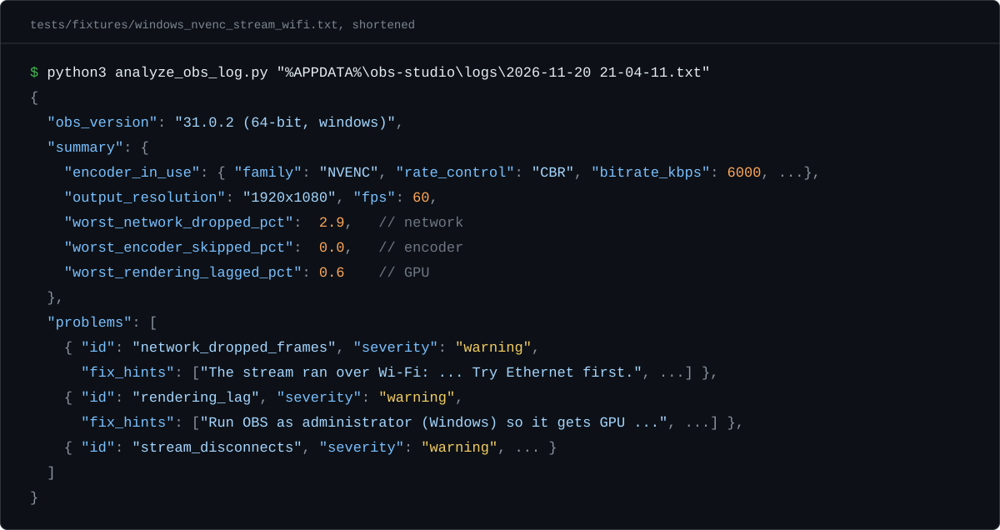

# obs-settings-advisor

[](https://github.com/mikahatdichlieb/obs-settings-advisor/actions/workflows/ci.yml)
[](LICENSE)

A skill for Claude that suggests OBS Studio settings for your PC. It looks at your hardware and
your OBS logs, checks the current requirements of Twitch, YouTube or Kick, and explains every
value it recommends. If you ask, it also writes a [blur](https://github.com/f0e/blur) config that
matches your recordings.

It only reads. Your OBS configuration is never changed; you apply the settings yourself.



## Install

### Claude Code

```text
/plugin marketplace add mikahatdichlieb/obs-settings-advisor
/plugin install obs-settings-advisor@obs-settings-advisor
```

Or copy the skill folder into your skills directory:

```bash
git clone https://github.com/mikahatdichlieb/obs-settings-advisor.git
mkdir -p ~/.claude/skills
cp -r obs-settings-advisor/skills/obs-settings-advisor ~/.claude/skills/
```

On Windows:

```powershell
git clone https://github.com/mikahatdichlieb/obs-settings-advisor.git
New-Item -ItemType Directory -Force "$HOME\.claude\skills" | Out-Null
Copy-Item -Recurse obs-settings-advisor\skills\obs-settings-advisor "$HOME\.claude\skills\"
```

### Claude.ai

Zip the skill folder (`cd skills && zip -r obs-settings-advisor.zip obs-settings-advisor`) and
upload it under Settings > Capabilities > Skills. Code execution has to be enabled.

Scripts on Claude.ai run in a cloud sandbox, not on your PC, so the skill will ask you to run the
hardware script locally and paste the result, and to attach your OBS log file
(OBS: Help > Log Files > Show Log Files).

## Usage

Ask Claude about your OBS setup, for example:

- "My Twitch stream drops frames in Apex. What should I change?"
- "Which settings should I use to record Valorant at 240 fps?"
- "Make me a blur config, a bit less blurry than the default."
- "Here's my blur config, why do my clips look so unclear?"

What the skill does:

1. Asks for what it can't detect: stream or record, platform, upload speed, which games.
2. Runs a hardware script: CPU, RAM, GPU and driver, hardware encoder, displays, OBS version.
3. Looks up the current platform limits and OBS documentation.
4. Finds your newest OBS log and analyzes it: encoder, resolution, FPS, and skipped, lagged and
   dropped frames.
5. Gives one table of settings with a reason for each value, plus alternatives where there is a
   real tradeoff. If your upload or hardware can't do what you're asking for, it says so.
6. Ends with a short test: record 2-3 minutes of gameplay, then analyze the new log.
7. Optionally writes a `.blur-config.cfg`. It first checks that the OBS recording suits blur
   (FPS, rate control, no skipped frames), and it can review existing configs, including old blur
   v1 configs whose keys v2 ignores.

## Scripts

The scripts also work without Claude. They print JSON and need nothing beyond the OS tools and
Python 3.8+.

| Script | Purpose |
|---|---|
| `detect_hardware.sh` / `.ps1` | Hardware and OBS version (bash for macOS and Linux, PowerShell for Windows) |
| `find_obs_logs.sh` / `.ps1` | Newest three OBS logs, and the newest one that contains a finished recording or stream |
| `analyze_obs_log.py` | Turns an OBS log into JSON with frame statistics and detected problems |

```bash
cd skills/obs-settings-advisor/scripts
bash detect_hardware.sh
bash find_obs_logs.sh
python3 analyze_obs_log.py "~/.config/obs-studio/logs/<file>.txt"
```

```powershell
cd skills\obs-settings-advisor\scripts
powershell -NoProfile -ExecutionPolicy Bypass -File detect_hardware.ps1
powershell -NoProfile -ExecutionPolicy Bypass -File find_obs_logs.ps1
python analyze_obs_log.py "%APPDATA%\obs-studio\logs\<file>.txt"
```

Output never contains your username, hostname, serial numbers, or MAC/IP addresses. Paths are
printed as `~`, `$USER` or `%APPDATA%`, and the analyzer accepts them in that form.

Problems the analyzer reports:

| ID | Meaning |
|---|---|
| `encoder_overloaded` | Frames skipped because the encoder can't keep up |
| `rendering_lag` | Frames lagged because the GPU is busy, usually with the game |
| `network_dropped_frames` | Frames dropped because the upload can't sustain the bitrate |
| `stream_disconnects`, `bitrate_congestion` | Connection lost or bitrate lowered during the stream |
| `configured_encoder_missing`, `hardware_encoder_error` | Encoder failed to load or errored, usually a driver problem |
| `obs_on_integrated_gpu` | OBS runs on the integrated GPU of a laptop that has a dedicated one |
| `stream_not_cbr`, `stream_keyframe_interval` | Stream encoder not set to CBR or 2 s keyframes |
| `fps_above_60`, `x264_with_hw_available`, `lookahead_under_load` | Settings that cost performance for little gain |

## Repository layout

```text
skills/obs-settings-advisor/
  SKILL.md          instructions Claude follows
  scripts/          detection, log finder, log analyzer
  references/       encoders, platform limits, log patterns, sources, blur
tests/              unit tests, sample OBS logs, macOS mocks
```

## Development

```bash
python3 tests/validate_skill.py
python3 -m unittest discover -s tests -v
```

CI runs the tests, ShellCheck and PSScriptAnalyzer on Ubuntu, macOS and Windows, and runs the
PowerShell scripts under both Windows PowerShell 5.1 and PowerShell 7.

Sample logs and fixes for hardware that isn't covered yet are welcome. Remove usernames, paths,
device IDs and stream URLs from logs before sharing them.

## License

MIT. Not affiliated with the OBS Project or blur.
